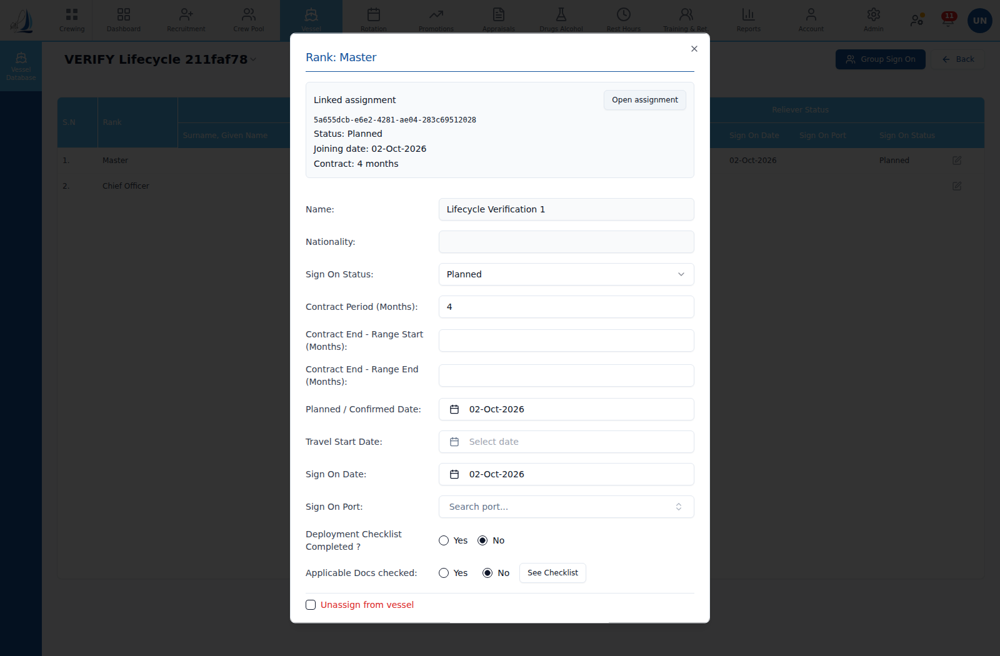
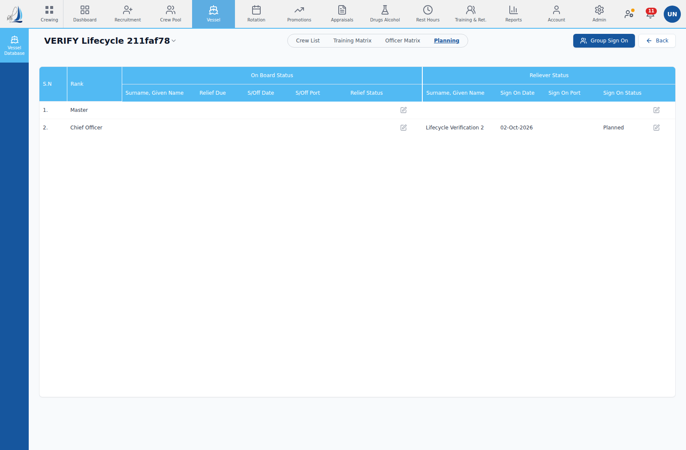

# Main-workspace assignment lifecycle verification

Date: 2026-10-02. All times UTC.

## Backend evidence reported before starting

- Main listening PID: **198**, port 5000.
- Backend process start: **2026-10-02T13:30:53.280Z**.
- Latest checked commit: `80248e1014e022466ac51291367efd16d3dc3cc3`.
- Commit time: **2026-10-02T08:01:51Z**.
- Backend start is strictly later than commit time. Same PID and HEAD verified at both ends of every stage.

## Method and limits

Dedicated verification vessel **VERIFY Lifecycle 211faf78** and two synthetic seafarers; no operational records or Company Form definitions were changed. Setup inserted fixture crew/vessel/pending rotation entries, and the normal Admin vessel-revision API configured Master/Chief Officer positions. No SQL manufactured lifecycle assignment links or statuses. Deployment, sign-on, sign-off, cancellation and rejection used normal live HTTP endpoints. Real browser interaction opened the reliever popup and clicked **Open assignment**. Screenshots show the actual application after each transition; this is not a claim that every lifecycle mutation was submitted by clicking its browser form.

The initial minimal vessel lacked configured positions, so its first browser check correctly could not open the reliever. Configuring test-vessel positions fixed the fixture prerequisite without changing product code. The deployment screenshot was recaptured after configuration and before sign-on; the recapture time below supersedes the initial database-list screenshot.

## Fixture identities

```json
{
  "vesselUuid": "f90095c9-4fb6-492d-bd95-b479fd4f5ae7",
  "firstCrew": "9939b1f0-7212-4caa-addd-f8452ef1aea6",
  "firstPlan": "dfaf01bb-bf13-46cf-8dc2-fe4302984c08",
  "firstAssignment": "5a655dcb-e6e2-4281-ae04-283c69512028",
  "secondCrew": "7a8ab98f-8126-4133-9f48-b41ddb1d715e",
  "secondPlan": "87437b9f-495b-4e6e-bd4e-ba20d72424ff",
  "secondAssignment": "d027f2a4-0a16-4ed2-b603-0ff356db792d"
}
```

First assignment moves from planning's reliever link to its incumbent `crew_assign_uuid` on sign-on, and remains that same UUID after sign-off. Sign-off preserves `assignment_type = OnBoard` as historical classification, with `is_current = false` and `sign_off_date = 2026-10-03`; it does not delete the row.

Second assignment is retained as `Cancelled`, noncurrent and not deleted, while both planning reliever references clear.

The exact rejected vessel literal is **744535d0-841a-11ed-aa7c-7003bca91a866**. The normal create endpoint returns **400: Assignment vessel ID must be a correctly formed UUID**. Three historical assignments already reference this malformed ID; before/after global counts remain three, and the second seafarer's assignment history is identical. No historical cleanup was authorized or performed.

## 1. Deploy first seafarer — PASS

Stage started: 2026-10-02T14:00:24.753Z. Screenshot captured: **2026-10-02T14:05:06.111Z**.

### Normal endpoint evidence

```json
[
  {
    "at": "2026-10-02T14:00:25.469Z",
    "method": "POST",
    "path": "/api/v2/rotation/entries/60c953b0-dc7a-45f2-8e9b-2a319904cf16/deploy",
    "status": 200,
    "response": {
      "success": true,
      "planUuid": "dfaf01bb-bf13-46cf-8dc2-fe4302984c08",
      "archiveUuid": "a47f12d5-4574-4bff-bb7e-918b24dcb6c6"
    }
  }
]
```

### Raw SQL and returned rows

```sql
SELECT plan_uuid,reliever_assign_uuid FROM vessel_planning_v2 WHERE plan_uuid=$1
```

Bound parameters:

```json
[
  "dfaf01bb-bf13-46cf-8dc2-fe4302984c08"
]
```

Actual returned rows:

```json
[
  {
    "plan_uuid": "dfaf01bb-bf13-46cf-8dc2-fe4302984c08",
    "reliever_assign_uuid": "5a655dcb-e6e2-4281-ae04-283c69512028"
  }
]
```

```sql
SELECT p.plan_uuid, p.vessel_uuid, p.rank_id, p.crew_uuid,
       p.crew_assign_uuid, p.reliever_crew_uuid, p.reliever_assign_uuid,
       p.joining_status, a.assign_uuid, a.crew_uuid AS assignment_crew_uuid,
       a.assignment_type, a.is_current, a.is_deleted, a.sign_on_date,
       a.sign_off_date, a.vessel_uuid AS assignment_vessel_uuid
FROM vessel_planning_v2 p
LEFT JOIN crew_assignments a ON a.assign_uuid = $2
WHERE p.plan_uuid = $1
```

Bound parameters:

```json
[
  "dfaf01bb-bf13-46cf-8dc2-fe4302984c08",
  "5a655dcb-e6e2-4281-ae04-283c69512028"
]
```

Actual returned rows:

```json
[
  {
    "plan_uuid": "dfaf01bb-bf13-46cf-8dc2-fe4302984c08",
    "vessel_uuid": "f90095c9-4fb6-492d-bd95-b479fd4f5ae7",
    "rank_id": "R001",
    "crew_uuid": null,
    "crew_assign_uuid": null,
    "reliever_crew_uuid": "9939b1f0-7212-4caa-addd-f8452ef1aea6",
    "reliever_assign_uuid": "5a655dcb-e6e2-4281-ae04-283c69512028",
    "joining_status": "Planned",
    "assign_uuid": "5a655dcb-e6e2-4281-ae04-283c69512028",
    "assignment_crew_uuid": "9939b1f0-7212-4caa-addd-f8452ef1aea6",
    "assignment_type": "Planned",
    "is_current": false,
    "is_deleted": false,
    "sign_on_date": "2026-10-02",
    "sign_off_date": null,
    "assignment_vessel_uuid": "f90095c9-4fb6-492d-bd95-b479fd4f5ae7"
  }
]
```

### Screenshot


## 2. Open real reliever popup and read assignment — PASS

Stage started: 2026-10-02T14:09:04.150Z. Screenshot captured: **2026-10-02T14:09:12.208Z**.

### Normal endpoint evidence

```json
[
  {
    "at": "2026-10-02T14:09:11.788Z",
    "method": "GET",
    "url": "/api/v2/vessel/planning/dfaf01bb-bf13-46cf-8dc2-fe4302984c08/reliever-assignment/5a655dcb-e6e2-4281-ae04-283c69512028",
    "status": 200,
    "response": {
      "assignUuid": "5a655dcb-e6e2-4281-ae04-283c69512028",
      "crewUuid": "9939b1f0-7212-4caa-addd-f8452ef1aea6",
      "vesselUuid": "f90095c9-4fb6-492d-bd95-b479fd4f5ae7",
      "assignmentType": "Planned",
      "signOnDate": "2026-10-02",
      "contractPeriod": "4",
      "portOfJoiningUuid": null
    }
  }
]
```

### Raw SQL and returned rows

```sql
SELECT p.plan_uuid, p.vessel_uuid, p.rank_id, p.crew_uuid,
       p.crew_assign_uuid, p.reliever_crew_uuid, p.reliever_assign_uuid,
       p.joining_status, a.assign_uuid, a.crew_uuid AS assignment_crew_uuid,
       a.assignment_type, a.is_current, a.is_deleted, a.sign_on_date,
       a.sign_off_date, a.vessel_uuid AS assignment_vessel_uuid
FROM vessel_planning_v2 p
LEFT JOIN crew_assignments a ON a.assign_uuid = $2
WHERE p.plan_uuid = $1
```

Bound parameters:

```json
[
  "dfaf01bb-bf13-46cf-8dc2-fe4302984c08",
  "5a655dcb-e6e2-4281-ae04-283c69512028"
]
```

Actual returned rows:

```json
[
  {
    "plan_uuid": "dfaf01bb-bf13-46cf-8dc2-fe4302984c08",
    "vessel_uuid": "f90095c9-4fb6-492d-bd95-b479fd4f5ae7",
    "rank_id": "R001",
    "crew_uuid": null,
    "crew_assign_uuid": null,
    "reliever_crew_uuid": "9939b1f0-7212-4caa-addd-f8452ef1aea6",
    "reliever_assign_uuid": "5a655dcb-e6e2-4281-ae04-283c69512028",
    "joining_status": "Planned",
    "assign_uuid": "5a655dcb-e6e2-4281-ae04-283c69512028",
    "assignment_crew_uuid": "9939b1f0-7212-4caa-addd-f8452ef1aea6",
    "assignment_type": "Planned",
    "is_current": false,
    "is_deleted": false,
    "sign_on_date": "2026-10-02",
    "sign_off_date": null,
    "assignment_vessel_uuid": "f90095c9-4fb6-492d-bd95-b479fd4f5ae7"
  }
]
```

### Screenshot



## 3. Sign on — PASS

Stage started: 2026-10-02T14:09:12.897Z. Screenshot captured: **2026-10-02T14:09:21.049Z**.

### Normal endpoint evidence

```json
[
  {
    "at": "2026-10-02T14:09:13.671Z",
    "method": "POST",
    "path": "/api/v2/vessel/planning/dfaf01bb-bf13-46cf-8dc2-fe4302984c08/sign-on",
    "status": 200,
    "response": {
      "id": 1110,
      "planUuid": "dfaf01bb-bf13-46cf-8dc2-fe4302984c08",
      "vesselUuid": "f90095c9-4fb6-492d-bd95-b479fd4f5ae7",
      "activeRevisionUuid": null,
      "rankId": "R001",
      "rank": "Master",
      "crewUuid": "9939b1f0-7212-4caa-addd-f8452ef1aea6",
      "crewAssignUuid": "5a655dcb-e6e2-4281-ae04-283c69512028",
      "crewStatus": "primary",
      "signOnDate": "2026-10-02",
      "reliefDue": "2027-02-02",
      "signOffDate": null,
      "signOffPortUuid": null,
      "signOffReason": null,
      "reliefStatus": null,
      "takeOverDate": null,
      "takeOverConfirmation": false,
      "handOverDate": null,
      "relieverCrewUuid": null,
      "relieverAssignUuid": null,
      "relieverSignOnDate": null,
      "joiningPortUuid": null,
      "joiningStatus": null,
      "plannedConfirmedDate": "2026-10-02",
      "travelStartDate": null,
      "travelEndDate": null,
      "contractPeriodMonths": 4,
      "contractEndRangeStartMonths": null,
      "contractEndRangeEndMonths": null,
      "relieverContractPeriodMonths": null,
      "relieverContractEndRangeStartMonths": null,
      "relieverContractEndRangeEndMonths": null,
      "deploymentChecklistCompleted": false,
      "applicableDocsChecked": false,
      "adminAccept": true,
      "isArchived": false,
      "isRelieverArchived": false,
      "archivedDate": null,
      "createdAt": "2026-10-02T14:00:25.026Z",
      "updatedAt": "2026-10-02T14:09:13.006Z",
      "createdByUuid": "main-lifecycle-verification",
      "updatedByUuid": null,
      "isDeleted": false,
      "isSync": false
    }
  }
]
```

### Raw SQL and returned rows

```sql
SELECT p.plan_uuid, p.vessel_uuid, p.rank_id, p.crew_uuid,
       p.crew_assign_uuid, p.reliever_crew_uuid, p.reliever_assign_uuid,
       p.joining_status, a.assign_uuid, a.crew_uuid AS assignment_crew_uuid,
       a.assignment_type, a.is_current, a.is_deleted, a.sign_on_date,
       a.sign_off_date, a.vessel_uuid AS assignment_vessel_uuid
FROM vessel_planning_v2 p
LEFT JOIN crew_assignments a ON a.assign_uuid = $2
WHERE p.plan_uuid = $1
```

Bound parameters:

```json
[
  "dfaf01bb-bf13-46cf-8dc2-fe4302984c08",
  "5a655dcb-e6e2-4281-ae04-283c69512028"
]
```

Actual returned rows:

```json
[
  {
    "plan_uuid": "dfaf01bb-bf13-46cf-8dc2-fe4302984c08",
    "vessel_uuid": "f90095c9-4fb6-492d-bd95-b479fd4f5ae7",
    "rank_id": "R001",
    "crew_uuid": "9939b1f0-7212-4caa-addd-f8452ef1aea6",
    "crew_assign_uuid": "5a655dcb-e6e2-4281-ae04-283c69512028",
    "reliever_crew_uuid": null,
    "reliever_assign_uuid": null,
    "joining_status": null,
    "assign_uuid": "5a655dcb-e6e2-4281-ae04-283c69512028",
    "assignment_crew_uuid": "9939b1f0-7212-4caa-addd-f8452ef1aea6",
    "assignment_type": "OnBoard",
    "is_current": true,
    "is_deleted": false,
    "sign_on_date": "2026-10-02",
    "sign_off_date": null,
    "assignment_vessel_uuid": "f90095c9-4fb6-492d-bd95-b479fd4f5ae7"
  }
]
```

### Screenshot


## 4. Sign off — PASS

Stage started: 2026-10-02T14:09:21.706Z. Screenshot captured: **2026-10-02T14:09:29.268Z**.

### Normal endpoint evidence

```json
[
  {
    "at": "2026-10-02T14:09:21.877Z",
    "method": "POST",
    "path": "/api/v2/vessel/planning/dfaf01bb-bf13-46cf-8dc2-fe4302984c08/sign-off",
    "status": 200,
    "response": {
      "id": 1110,
      "planUuid": "dfaf01bb-bf13-46cf-8dc2-fe4302984c08",
      "vesselUuid": "f90095c9-4fb6-492d-bd95-b479fd4f5ae7",
      "activeRevisionUuid": null,
      "rankId": "R001",
      "rank": "Master",
      "crewUuid": "9939b1f0-7212-4caa-addd-f8452ef1aea6",
      "crewAssignUuid": "5a655dcb-e6e2-4281-ae04-283c69512028",
      "crewStatus": "primary",
      "signOnDate": "2026-10-02",
      "reliefDue": "2027-02-02",
      "signOffDate": "2026-10-03",
      "signOffPortUuid": null,
      "signOffReason": "Dedicated lifecycle verification complete",
      "reliefStatus": "Signed Off",
      "takeOverDate": null,
      "takeOverConfirmation": false,
      "handOverDate": null,
      "relieverCrewUuid": null,
      "relieverAssignUuid": null,
      "relieverSignOnDate": null,
      "joiningPortUuid": null,
      "joiningStatus": null,
      "plannedConfirmedDate": "2026-10-02",
      "travelStartDate": null,
      "travelEndDate": null,
      "contractPeriodMonths": 4,
      "contractEndRangeStartMonths": null,
      "contractEndRangeEndMonths": null,
      "relieverContractPeriodMonths": null,
      "relieverContractEndRangeStartMonths": null,
      "relieverContractEndRangeEndMonths": null,
      "deploymentChecklistCompleted": false,
      "applicableDocsChecked": false,
      "adminAccept": true,
      "isArchived": true,
      "isRelieverArchived": false,
      "archivedDate": "2026-10-02",
      "createdAt": "2026-10-02T14:00:25.026Z",
      "updatedAt": "2026-10-02T14:09:21.806Z",
      "createdByUuid": "main-lifecycle-verification",
      "updatedByUuid": "24",
      "isDeleted": false,
      "isSync": false,
      "crewFirstName": "Lifecycle",
      "crewMiddleName": null,
      "crewFamilyName": "Verification 1",
      "crewMemberName": "Lifecycle Verification 1",
      "crewEmpNo": "VERIFY-211faf78-1",
      "nationality": null,
      "relieverFirstName": null,
      "relieverMiddleName": null,
      "relieverFamilyName": null,
      "relieverCrewName": null,
      "relieverNationality": null,
      "signOffPortName": null,
      "joiningPortName": null,
      "handoverAttachmentCount": 0
    }
  }
]
```

### Raw SQL and returned rows

```sql
SELECT p.plan_uuid, p.vessel_uuid, p.rank_id, p.crew_uuid,
       p.crew_assign_uuid, p.reliever_crew_uuid, p.reliever_assign_uuid,
       p.joining_status, a.assign_uuid, a.crew_uuid AS assignment_crew_uuid,
       a.assignment_type, a.is_current, a.is_deleted, a.sign_on_date,
       a.sign_off_date, a.vessel_uuid AS assignment_vessel_uuid
FROM vessel_planning_v2 p
LEFT JOIN crew_assignments a ON a.assign_uuid = $2
WHERE p.plan_uuid = $1
```

Bound parameters:

```json
[
  "dfaf01bb-bf13-46cf-8dc2-fe4302984c08",
  "5a655dcb-e6e2-4281-ae04-283c69512028"
]
```

Actual returned rows:

```json
[
  {
    "plan_uuid": "dfaf01bb-bf13-46cf-8dc2-fe4302984c08",
    "vessel_uuid": "f90095c9-4fb6-492d-bd95-b479fd4f5ae7",
    "rank_id": "R001",
    "crew_uuid": "9939b1f0-7212-4caa-addd-f8452ef1aea6",
    "crew_assign_uuid": "5a655dcb-e6e2-4281-ae04-283c69512028",
    "reliever_crew_uuid": null,
    "reliever_assign_uuid": null,
    "joining_status": null,
    "assign_uuid": "5a655dcb-e6e2-4281-ae04-283c69512028",
    "assignment_crew_uuid": "9939b1f0-7212-4caa-addd-f8452ef1aea6",
    "assignment_type": "OnBoard",
    "is_current": false,
    "is_deleted": false,
    "sign_on_date": "2026-10-02",
    "sign_off_date": "2026-10-03",
    "assignment_vessel_uuid": "f90095c9-4fb6-492d-bd95-b479fd4f5ae7"
  }
]
```

### Screenshot


## 5. Deploy second seafarer — PASS

Stage started: 2026-10-02T14:09:30.000Z. Screenshot captured: **2026-10-02T14:09:37.683Z**.

### Normal endpoint evidence

```json
[
  {
    "at": "2026-10-02T14:09:30.206Z",
    "method": "POST",
    "path": "/api/v2/rotation/entries/016d418e-3252-4baa-95a5-5c0ca2164461/deploy",
    "status": 200,
    "response": {
      "success": true,
      "planUuid": "87437b9f-495b-4e6e-bd4e-ba20d72424ff",
      "archiveUuid": "62398240-85fc-4772-8e40-260354127206"
    }
  }
]
```

### Raw SQL and returned rows

```sql
SELECT plan_uuid,reliever_assign_uuid FROM vessel_planning_v2 WHERE plan_uuid=$1
```

Bound parameters:

```json
[
  "87437b9f-495b-4e6e-bd4e-ba20d72424ff"
]
```

Actual returned rows:

```json
[
  {
    "plan_uuid": "87437b9f-495b-4e6e-bd4e-ba20d72424ff",
    "reliever_assign_uuid": "d027f2a4-0a16-4ed2-b603-0ff356db792d"
  }
]
```

```sql
SELECT p.plan_uuid, p.vessel_uuid, p.rank_id, p.crew_uuid,
       p.crew_assign_uuid, p.reliever_crew_uuid, p.reliever_assign_uuid,
       p.joining_status, a.assign_uuid, a.crew_uuid AS assignment_crew_uuid,
       a.assignment_type, a.is_current, a.is_deleted, a.sign_on_date,
       a.sign_off_date, a.vessel_uuid AS assignment_vessel_uuid
FROM vessel_planning_v2 p
LEFT JOIN crew_assignments a ON a.assign_uuid = $2
WHERE p.plan_uuid = $1
```

Bound parameters:

```json
[
  "87437b9f-495b-4e6e-bd4e-ba20d72424ff",
  "d027f2a4-0a16-4ed2-b603-0ff356db792d"
]
```

Actual returned rows:

```json
[
  {
    "plan_uuid": "87437b9f-495b-4e6e-bd4e-ba20d72424ff",
    "vessel_uuid": "f90095c9-4fb6-492d-bd95-b479fd4f5ae7",
    "rank_id": "R002",
    "crew_uuid": null,
    "crew_assign_uuid": null,
    "reliever_crew_uuid": "7a8ab98f-8126-4133-9f48-b41ddb1d715e",
    "reliever_assign_uuid": "d027f2a4-0a16-4ed2-b603-0ff356db792d",
    "joining_status": "Planned",
    "assign_uuid": "d027f2a4-0a16-4ed2-b603-0ff356db792d",
    "assignment_crew_uuid": "7a8ab98f-8126-4133-9f48-b41ddb1d715e",
    "assignment_type": "Planned",
    "is_current": false,
    "is_deleted": false,
    "sign_on_date": "2026-10-02",
    "sign_off_date": null,
    "assignment_vessel_uuid": "f90095c9-4fb6-492d-bd95-b479fd4f5ae7"
  }
]
```

### Screenshot



## 6. Unassign second seafarer — PASS

Stage started: 2026-10-02T14:09:38.390Z. Screenshot captured: **2026-10-02T14:09:45.881Z**.

### Normal endpoint evidence

```json
[
  {
    "at": "2026-10-02T14:09:38.518Z",
    "method": "PATCH",
    "path": "/api/v2/vessel/planning/87437b9f-495b-4e6e-bd4e-ba20d72424ff",
    "status": 200,
    "response": {
      "id": 1111,
      "planUuid": "87437b9f-495b-4e6e-bd4e-ba20d72424ff",
      "vesselUuid": "f90095c9-4fb6-492d-bd95-b479fd4f5ae7",
      "activeRevisionUuid": null,
      "rankId": "R002",
      "rank": "Chief Officer",
      "crewUuid": null,
      "crewAssignUuid": null,
      "crewStatus": "primary",
      "signOnDate": null,
      "reliefDue": null,
      "signOffDate": null,
      "signOffPortUuid": null,
      "signOffReason": null,
      "reliefStatus": null,
      "takeOverDate": null,
      "takeOverConfirmation": false,
      "handOverDate": null,
      "relieverCrewUuid": null,
      "relieverAssignUuid": null,
      "relieverSignOnDate": null,
      "joiningPortUuid": null,
      "joiningStatus": null,
      "plannedConfirmedDate": null,
      "travelStartDate": null,
      "travelEndDate": null,
      "contractPeriodMonths": null,
      "contractEndRangeStartMonths": null,
      "contractEndRangeEndMonths": null,
      "relieverContractPeriodMonths": null,
      "relieverContractEndRangeStartMonths": null,
      "relieverContractEndRangeEndMonths": null,
      "deploymentChecklistCompleted": null,
      "applicableDocsChecked": null,
      "adminAccept": true,
      "isArchived": false,
      "isRelieverArchived": false,
      "archivedDate": null,
      "createdAt": "2026-10-02T14:09:30.096Z",
      "updatedAt": "2026-10-02T14:09:38.487Z",
      "createdByUuid": "main-lifecycle-verification",
      "updatedByUuid": "24",
      "isDeleted": false,
      "isSync": false
    }
  }
]
```

### Raw SQL and returned rows

```sql
SELECT p.plan_uuid, p.vessel_uuid, p.rank_id, p.crew_uuid,
       p.crew_assign_uuid, p.reliever_crew_uuid, p.reliever_assign_uuid,
       p.joining_status, a.assign_uuid, a.crew_uuid AS assignment_crew_uuid,
       a.assignment_type, a.is_current, a.is_deleted, a.sign_on_date,
       a.sign_off_date, a.vessel_uuid AS assignment_vessel_uuid
FROM vessel_planning_v2 p
LEFT JOIN crew_assignments a ON a.assign_uuid = $2
WHERE p.plan_uuid = $1
```

Bound parameters:

```json
[
  "87437b9f-495b-4e6e-bd4e-ba20d72424ff",
  "d027f2a4-0a16-4ed2-b603-0ff356db792d"
]
```

Actual returned rows:

```json
[
  {
    "plan_uuid": "87437b9f-495b-4e6e-bd4e-ba20d72424ff",
    "vessel_uuid": "f90095c9-4fb6-492d-bd95-b479fd4f5ae7",
    "rank_id": "R002",
    "crew_uuid": null,
    "crew_assign_uuid": null,
    "reliever_crew_uuid": null,
    "reliever_assign_uuid": null,
    "joining_status": null,
    "assign_uuid": "d027f2a4-0a16-4ed2-b603-0ff356db792d",
    "assignment_crew_uuid": "7a8ab98f-8126-4133-9f48-b41ddb1d715e",
    "assignment_type": "Cancelled",
    "is_current": false,
    "is_deleted": false,
    "sign_on_date": "2026-10-02",
    "sign_off_date": null,
    "assignment_vessel_uuid": "f90095c9-4fb6-492d-bd95-b479fd4f5ae7"
  }
]
```

### Screenshot


## 7. Refuse requested invalid vessel ID — PASS

Stage started: 2026-10-02T14:12:46.113Z. Screenshot captured: **2026-10-02T14:13:03.193Z**.

### Normal endpoint evidence

```json
[
  {
    "at": "2026-10-02T14:12:46.456Z",
    "method": "POST",
    "path": "/api/v2/crew-pool/crew/7a8ab98f-8126-4133-9f48-b41ddb1d715e/assignments",
    "status": 400,
    "response": {
      "error": "Assignment vessel ID must be a correctly formed UUID"
    }
  }
]
```

### Raw SQL and returned rows

```sql
SELECT count(*)::int AS matching_assignments FROM crew_assignments WHERE vessel_uuid=$1
```

Bound parameters:

```json
[
  "744535d0-841a-11ed-aa7c-7003bca91a866"
]
```

Actual returned rows:

```json
[
  {
    "matching_assignments": 3
  }
]
```

```sql
SELECT assign_uuid,vessel_uuid,assignment_type,is_current,is_deleted FROM crew_assignments WHERE crew_uuid=$1 ORDER BY assign_uuid
```

Bound parameters:

```json
[
  "7a8ab98f-8126-4133-9f48-b41ddb1d715e"
]
```

Actual returned rows:

```json
[
  {
    "assign_uuid": "d027f2a4-0a16-4ed2-b603-0ff356db792d",
    "vessel_uuid": "f90095c9-4fb6-492d-bd95-b479fd4f5ae7",
    "assignment_type": "Cancelled",
    "is_current": false,
    "is_deleted": false
  }
]
```

```sql
SELECT assign_uuid,vessel_uuid,assignment_type,is_current,is_deleted FROM crew_assignments WHERE crew_uuid=$1 ORDER BY assign_uuid
```

Bound parameters:

```json
[
  "7a8ab98f-8126-4133-9f48-b41ddb1d715e"
]
```

Actual returned rows:

```json
[
  {
    "assign_uuid": "d027f2a4-0a16-4ed2-b603-0ff356db792d",
    "vessel_uuid": "f90095c9-4fb6-492d-bd95-b479fd4f5ae7",
    "assignment_type": "Cancelled",
    "is_current": false,
    "is_deleted": false
  }
]
```

```sql
SELECT count(*)::int AS matching_assignments FROM crew_assignments WHERE vessel_uuid=$1
```

Bound parameters:

```json
[
  "744535d0-841a-11ed-aa7c-7003bca91a866"
]
```

Actual returned rows:

```json
[
  {
    "matching_assignments": 3
  }
]
```

### Screenshot


## Scope against the task ledger

- **#360:** sequential deploy → exact popup read → linked unassign: PASS. No concurrent race stress claim.
- **#361:** canonical relationship-scoped write path used successfully for validation. Retired URL coverage is NOT part of this walkthrough.
- **#362:** exact assignment UUID across sign-on/sign-off: PASS.
- **#365:** normal linked unassign was exercised, but the exceptional administrator-only clear of an unlinked legacy reliever was NOT TESTED.
- **#368:** requested malformed vessel-ID write refused; no new/changed assignment: PASS. Other missing/unknown-vessel branches were not retested.
- #363, #364, #366 and #367 have no completed rows in the audited ledger; no completion claims are invented for them.

These are new checks on the currently delivered implementation, not retrospective certification of older screenshots or task-agent restart claims.
